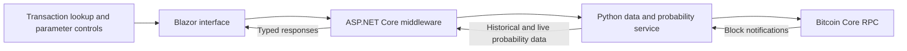

# Spring 2026 capstone origins

The original **Bitcoin Double-Spend Website** was developed for **CSCE A470 at the University of Alaska Anchorage** by **Derek Hodgkins, Caden Kane, Lars Goozen, and Zong Xiong**, with project advisor **Sebastian Neumayer**.

This note summarizes the recovered design presentation, design document, final report dated April 30, 2026, and final poster. It documents the original team project. The repository's current `backend/` and `frontend/` contain a later FastAPI/React rebuild; the capstone's .NET/Blazor components remain under `dscap-api/`, `dscap-web/`, and `dscap-py-worker/` for reference.

## Original goal

Combine transaction lookup with visual explanations of modeled double-spend risk. A user enters a Bitcoin transaction ID, reviews transaction details and confirmations, and explores historical and live probability curves under a chosen attacker hash-power assumption.

The capstone queried a Bitcoin Core node. Its Python processor normalized RPC data, calculated probability points, and exposed HTTP and WebSocket interfaces. ASP.NET Core middleware mapped the responses into typed models consumed by the Blazor interface.

The diagram is a new summary of the team's report; it omits original deployment addresses and credentials.

## Engineering decisions

- **Separate responsibilities.** Node access, probability calculation, middleware models, and charts had distinct roles.
- **Preserve chart meaning.** Time-based curves and confirmation-step plots needed different axes and presentation.
- **Control graph size.** Long transaction histories required downsampling rather than emitting a point for every elapsed second.
- **Treat transaction categories explicitly.** Mempool, coinbase, old, and recently confirmed transactions exposed different missing fields and update behavior.

The final report describes bugs involving missing timestamps displayed as 1969, inconsistent confirmation fields, coinbase input assumptions, middleware DTO mismatches, and parameter changes during live updates. These experiences motivated the report's proposed regression cases and clearer model explanations.

## Team contribution record

The design presentation assigned Lars Goozen to testing, frontend/backend work, and the Python worker's probability mathematics. It assigned Caden Kane to testing, backend/worker API work, and the Bitcoin node; Derek Hodgkins to testing, frontend/backend work, and the web API; and Zong Xiong to testing and the web interface. These are documented planning roles, not a claim that the final work was partitioned exclusively that way. The report and poster are joint team artifacts.

## Historical limitations

The April 2026 report describes a prototype dependent on a synchronized Bitcoin Core node and that node's mempool. It identifies deployment packaging, automated transaction-case tests, caching, and explanatory probability text as future work at that time. Those statements describe the capstone snapshot and should not be read as an audit of the later rebuilt application.

The probability depends on the model and attacker-share assumption. The project visualizes those assumptions; its output does not guarantee transaction finality.

## Source record

Recovered original artifacts: `Bitcoin Double Spend Design Document.pdf`, `DesignPres.pptx`, `FinalWriteupBTCDSW.pdf`, `PosterFinal_cmyk.pdf`, and its editable poster deck. Their hashes are in [source-record.json](source-record.json). New summary prose and a diagram are published here rather than the unredacted reports, internal infrastructure references, or meeting logs.

The report and poster cite S. Nakamoto's *Bitcoin: A Peer-to-Peer Electronic Cash System* (2008) and S. Neumayer, M. Varia, and I. Eyal's *An Analysis of Acceptance Policies for Blockchain Transactions* (2018). The probability model is attributed to that prior research, not invented by the capstone team.
